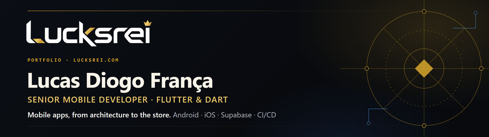
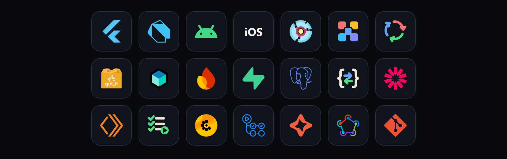
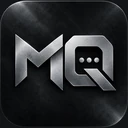

  <a href="https://lucksrei.com">Portafolio</a> · <a href="https://lucksrei.com/apps/">Apps</a> · <a href="https://www.linkedin.com/in/lucas-diogo-aa39b9174/">LinkedIn</a> · <a href="https://lucksrei.com/contact/">Contacto</a>

<a href="README.md">English</a> · <a href="README.pt-BR.md">Português</a> · <b>Español</b>

## Sobre mí

Soy **Senior Mobile Developer** especializado en **Flutter y Dart**, con **más de 10 años en software** (desde 2015) y **Flutter desde 2019**. Entrego apps Android e iOS a lo largo de todo el ciclo del producto: arquitectura, UI, integraciones, pruebas automatizadas, CI/CD y publicación en las tiendas.

En **Cooper Tec** trabajo en las apps Flutter de una plataforma financiera white-label; antes pasé por **Agrosmart** y **Toro Investimentos**. Fuera del trabajo para clientes, diseño, construyo y mantengo mis propios productos con **[Lucksrei](https://lucksrei.com)**, desde el primer prototipo hasta la App Store.

Valoro la arquitectura limpia, las decisiones de ingeniería pragmáticas, las integraciones resilientes y las apps que se sienten bien en dispositivos reales.

## Experiencia técnica

<table>
<tr><td><b>Mobile</b></td><td>Flutter · Dart · Android · iOS</td></tr>
<tr><td><b>Arquitectura y estado</b></td><td>Clean Architecture · SOLID · TDD · inyección de dependencias · BLoC / Cubit · Provider</td></tr>
<tr><td><b>Backend y datos</b></td><td>Firebase · Supabase · PostgreSQL · REST APIs · JWT · Cloudflare Workers</td></tr>
<tr><td><b>Calidad</b></td><td>Pruebas unitarias, de widgets y de integración · Crashlytics</td></tr>
<tr><td><b>Entrega</b></td><td>GitHub Actions · CodeMagic · Fastlane · Git</td></tr>
</table>

## Productos destacados

<table>
<tr>
<td width="50%" valign="top" align="center"> <b>La Pelve</b> Gestión clínica para fisioterapeutas de salud pélvica: agenda, historias clínicas, evoluciones y control de pagos.  <b>Flutter · Supabase · PostgreSQL</b> <a href="https://github.com/Lucasdiogof/la-pelve">Repositorio</a> · <a href="https://lucksrei.com/projects/la-pelve/">Caso de estudio</a> · <a href="https://apps.apple.com/br/app/la-pelve/id6811234099">App Store</a>  </td>
<td width="50%" valign="top" align="center"> <b>Goiás App</b> App para hinchas del Goiás: partidos, contenido del club, entradas, membresía y una Arena de minijuegos. Construida sobre una base Flutter multi-club.  <b>Flutter · Supabase · Cloudflare Workers</b> <a href="https://github.com/Lucasdiogof/fan-hub">Repositorio</a> · <a href="https://lucksrei.com/projects/fan-hub/">Caso de estudio</a>  </td>
</tr>
<tr>
<td width="50%" valign="top" align="center"> <b>Aprovaura</b> App de estudio para exámenes de ingreso: preguntas por materia, simulacros, revisión de errores y redacción, con progreso gamificado.  <b>Flutter · Supabase · PostgreSQL</b> <a href="https://github.com/Lucasdiogof/aprovaura">Repositorio</a> · <a href="https://lucksrei.com/projects/aura/">Caso de estudio</a> · <a href="https://apps.apple.com/br/app/aprovaura/id6817047910">App Store</a>  </td>
<td width="50%" valign="top" align="center"> <b>Match Queue</b> Cola de matchmaking en tiempo real para equipos competitivos: turnos ordenados, roles de equipo y actualizaciones en vivo.  <b>Flutter · Supabase Realtime · PostgreSQL</b> <a href="https://github.com/Lucasdiogof/match-queue">Repositorio</a> · <a href="https://lucksrei.com/projects/match-queue/">Caso de estudio</a> · <a href="https://apps.apple.com/br/app/match-queue/id6810790338">App Store</a>  </td>
</tr>
</table>

## Contacto

Abierto a conversar sobre ingeniería móvil y producto.

- **Portafolio:** [lucksrei.com](https://lucksrei.com)
- **Página de contacto:** [lucksrei.com/contact](https://lucksrei.com/contact/)
- **LinkedIn:** [lucas-diogo](https://www.linkedin.com/in/lucas-diogo-aa39b9174/)
- **Correo:** [marketing@lucksrei.com](mailto:marketing@lucksrei.com)
